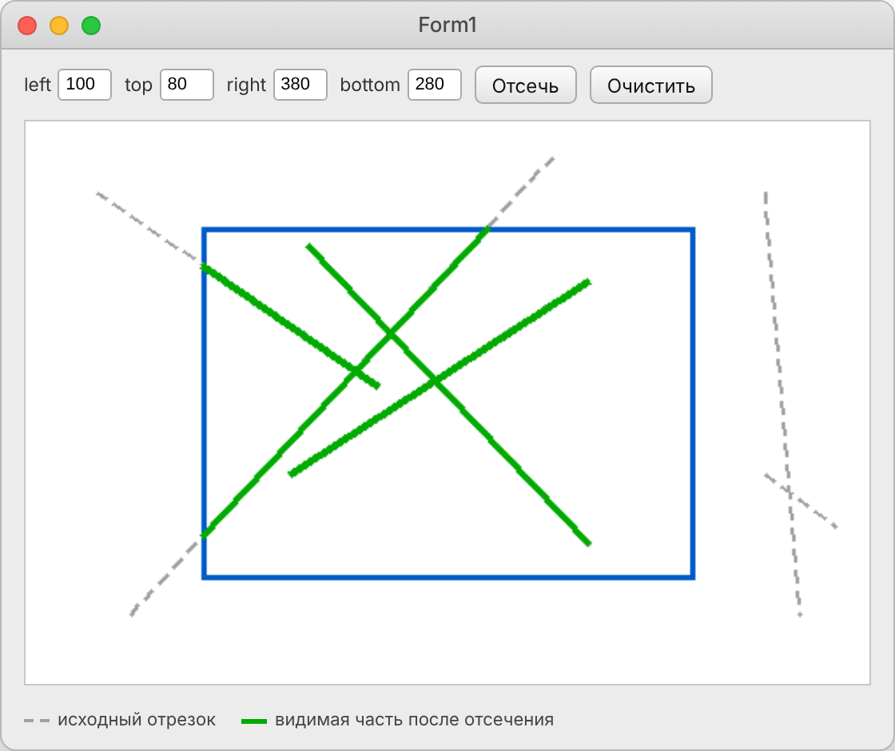

# Лабораторная работа №9. Отсечение отрезков

**Дисциплина:** Компьютерная графика
**Среда разработки:** Lazarus IDE (Free Pascal Compiler)
**Задание:** разработать программу отсечения отрезков прямоугольным окном с их последующей отрисовкой; количество отрезков, их координаты и границы окна задаются пользователем.

## Постановка задачи

Реализовать алгоритм отсечения отрезков прямоугольным окном (алгоритм Сазерленда-Коэна с кодированием концов отрезка относительно окна). Пользователь задаёт границы окна отсечения и произвольное количество отрезков (кликами на поле рисования), после чего программа определяет видимую (внутри окна) часть каждого отрезка и отображает результат.

## Инструменты

- Free Pascal Compiler (FPC)
- Lazarus IDE
- Компоненты LCL: `TPaintBox`, `TCanvas`, `TEdit`, `TButton`

## Решение

Форма содержит:

| Компонент | Имя | Назначение |
|---|---|---|
| TPaintBox | `PaintBox1` | поле рисования: ввод отрезков кликами и вывод результата |
| TEdit | `EditWinLeft`, `EditWinTop`, `EditWinRight`, `EditWinBottom` | границы окна отсечения |
| TButton | `ButtonClip` | "Отсечь" |
| TButton | `ButtonClear` | "Очистить" |

Алгоритм отсечения реализован классическим методом **Сазерленда-Коэна**: каждой точке отрезка относительно окна присваивается 4-битный код (`LEFT`, `RIGHT`, `TOP`, `BOTTOM` – какие границы нарушены), затем:

- если оба кода равны 0 – отрезок целиком внутри окна (тривиальное принятие);
- если побитовое "И" кодов не равно 0 – отрезок целиком вне окна с одной стороны (тривиальное отбрасывание);
- иначе отрезок пересекает хотя бы одну границу – находится точка пересечения с соответствующей стороной окна, один из концов отрезка переносится в эту точку, коды пересчитываются, и цикл повторяется, пока не сработает одно из двух тривиальных условий.

Код приложения находится в файле [`Unit1.pas`](Unit1.pas).

Логика работы:
- **Клик мышью по полю** – первый клик задаёт начало отрезка, второй – конец; каждая новая пара кликов добавляет новый отрезок в список
- **Кнопка «Отсечь»** – применяет алгоритм Сазерленда-Коэна ко всем введённым отрезкам относительно окна, заданного полями границ, и отрисовывает видимые части
- **Кнопка «Очистить»** – удаляет все отрезки и сбрасывает результат

## Демонстрация работы

**Результат отсечения нескольких отрезков прямоугольным окном**

Синим показано окно отсечения (100, 80, 380, 280), серым пунктиром – исходные отрезки целиком, зелёным – видимая (оставшаяся после отсечения) часть каждого отрезка. Хорошо видно разные случаи: отрезки, пересекающие одну или две границы окна (их пунктир обрезается зелёной частью точно по границе окна), и два отрезка, полностью лежащие вне окна справа (остаются только серым пунктиром – зелёной части для них нет, так как они невидимы целиком).

## Как запустить

1. Создать новый проект Application в Lazarus.
2. Разместить на форме компоненты по таблице выше с точными именами.
3. Вставить код `Unit1.pas` целиком, привязать `OnClick`/`OnPaint`/`OnMouseDown`.
4. На macOS при ошибке линковщика `ld: malformed method list atom` добавить `-WM10.9` в Project Options → Compiler Options → Custom Options.
5. Запустить: задать границы окна → кликами нарисовать отрезки (по два клика на отрезок) → "Отсечь".

## Вывод

Алгоритм Сазерленда-Коэна эффективен за счёт двух тривиальных проверок (полностью внутри / полностью снаружи с одной стороны), которые отбрасывают большинство отрезков без вычисления точек пересечения – это особенно выгодно, когда окно отсечения мало относительно всей сцены. Для отрезков, пересекающих границы окна, требуется от одной до нескольких итераций пересчёта кода и нахождения точки пересечения, но их число ограничено (не более четырёх – по числу сторон окна). В результате отсечения каждый отрезок либо отбрасывается целиком, либо заменяется своей видимой частью, координаты которой лежат строго в пределах заданного прямоугольного окна.
